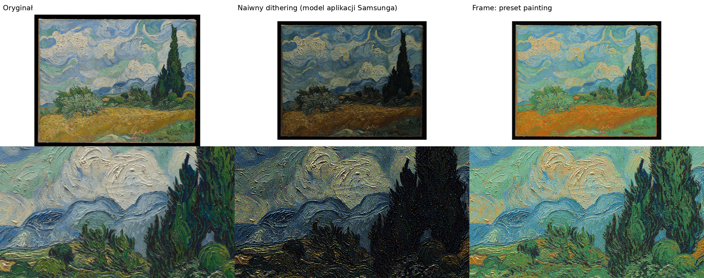

# Algorytm obrazu

Kod: `server/src/frame_server/imaging/`. Eksperymenty z poziomu CLI:

```bash
uv run frame render obraz.jpg out.png -p painting --preview podglad.png
uv run frame render obraz.jpg out.png -p photo --set tone.gamma=1.25 --set dither.method='"atkinson"'
```

`out.png` to plik dla ekranu (tylko czyste kolory farb), a `podglad.png` to
symulacja wyglądu na ekranie z uwzględnieniem adaptacji oka do „bieli” papieru.



*Van Gogh, „Pole pszenicy z cyprysami” (The Met, domena publiczna). Od lewej:
oryginał, model naiwnego ditheringu (tak przypuszczalnie działa ścieżka
Samsunga), nasz preset `painting`. Symulacja używa palety referencyjnej
Spectra 6; od E5 domyślna jest zmierzona paleta EM32DX.*

## Problem

Spectra 6 ma tylko 6 farb, a te są ciemne i mało nasycone:

| farba | wartość nominalna | wygląd (pomiar ref.) |
|---|---|---|
| czarna | 0, 0, 0 | 2, 2, 2 |
| biała | 255, 255, 255 | **190, 190, 190** |
| żółta | 255, 255, 0 | 205, 202, 0 *(jaśniejsza niż biel!)* |
| czerwona | 255, 0, 0 | **135, 19, 0** |
| niebieska | 0, 0, 255 | **5, 64, 158** |
| zielona | 0, 255, 0 | **39, 102, 60** |

Dithering liczony na wartościach nominalnych jest przekonany, że miesza jasne
kolory, a w rzeczywistości miesza ciemne. Efekt: obraz za ciemny i zgaszony.

## Etapy przetwarzania

1. **Wczytanie**: orientacja z EXIF, konwersja profilu ICC do sRGB (zdjęcia z iPhone'a są w Display P3), spłaszczenie przezroczystości na białe tło.
2. **Kompozycja** (`layout.py`): płótno 2560×1440 albo 1440×2560. Tryb `fill` kadruje z punktem ciężkości `focus_x/y`, tryb `fit` zostawia passe-partout (`margin`, kolor `white` / `black` / `edge`), tryb `auto` wybiera `fill`, gdy kadrowanie zabiera mniej niż ~12%. Skalowanie odbywa się w świetle liniowym (Lanczos).
3. **Wyostrzenie** (`filters.py`): unsharp mask na jasności OKLab, więc bez kolorowych obwódek. Dithering rozmywa drobne detale, a lekkie wyostrzenie je odzyskuje.
4. **Mapowanie tonów** (`tone.py`) na jasności OKLab L: ekspozycja, `gamma` (półtony), `shadows` (podniesienie cieni), `highlights`, `contrast` (krzywa S). Na koniec `compress_range` mapuje czerń–biel źródła na **czerń–biel panelu** (a nie na najjaśniejszą farbę, czyli żółtą).
5. **Mapowanie gamutu** (`gamut.py`): kolory osiągalne przez mieszanie farb tworzą bryłę wypukłą w liniowym RGB. Dla każdej pary (L, odcień) wyznaczamy maksymalne nasycenie i miękko kompresujemy nasycenie powyżej progu `gamut_knee`. Bez tego ditherer goni kolory, których nie da się uzyskać, i daje szum.
6. **Dithering** (`dither.py`, numba): dyfuzja błędu w świetle liniowym, wybór farby w OKLab. Jądra: Floyd–Steinberg, Atkinson, Jarvis, Stucki, Burkes, Sierra, Sierra Lite. Do tego skanowanie serpentynowe i ograniczanie błędu (`error_clamp`).
7. **Zapis**: indeksy farb zamieniamy na wartości **nominalne** (dla firmware'u). Wynik to PNG, ewentualnie JPEG 4:4:4 q95.
8. **Podgląd**: indeksy farb zamieniamy na kolory **zmierzone** i normalizujemy do bieli papieru. Ten obraz trafia do aplikacji iOS.

## Strategie (wybór po eksperymencie E5)

| strategia | co wysyłamy | kiedy |
|---|---|---|
| `passthrough` | tylko przeskalowany obraz; całą resztę robi ekran | punkt odniesienia (tak robi aplikacja Samsunga) |
| `compensate` | obraz po naszym mapowaniu tonów i gamutu, wstępnie skorygowany macierzą afiniczną (farby nominalne → zmierzone), tak żeby dithering ekranu trafił w nasz cel | gdy ekran przetwarza każdy obraz po swojemu |
| `dither` | gotowy obraz z samych czystych farb | gdy ekran pokazuje czyste farby 1:1 (najlepsza kontrola) |

## Presety

| preset | dla | najważniejsze ustawienia |
|---|---|---|
| `photo` | zdjęcia | gamma 1.15, cienie +0.35, nasycenie 1.2, wyostrzenie 0.6 |
| `painting` | obrazy olejne, akwarele | passe-partout 5%, gamma 1.1, nasycenie 1.15 |
| `graphic` | plakaty, ilustracje, drzeworyty | Atkinson, kontrast 1.2, nasycenie 1.3 |
| `bw` | rysunki, grafiki, zdjęcia czarno-białe | tylko czarna i biała farba, Jarvis |

Pełna lista parametrów: `GET /api/presets` albo modele `RenderSettings`,
`ToneSettings`, `DitherSettings` i `LayoutSettings` w kodzie.

## Kadrowanie i passe-partout

`imaging/layout.py` planuje płótno (`plan_layout`): każdy tryb to zestaw
okienek z fragmentem obrazu, a reszta to passe-partout.

| tryb | co widać |
|---|---|
| `fit` (passe-partout) | cały obraz w okienku, margines według ustawienia; po korekcie dowolny fragment i kształt okienka (oryginalny, 1:1, 4:5, 3:4, 2:3, 4:3, 3:2, 16:9) |
| `fill` (wypełnij) | cała szerokość albo wysokość obrazu, kadr ustawiony automatycznie na to, co najciekawsze |
| `details` (detale) | cały obraz od krawędzi do krawędzi (na pełną wysokość albo szerokość) i dwa przybliżone fragmenty w okienkach obok; gdy proporcje obrazu są bliskie ramce, obraz jest mniejszy, w okienku passe-partout, a detale stoją obok, równo z nim |
| `description` (opis) | jak `details`, ale zamiast drugiego detalu krótki opis nadrukowany na passe-partout |
| `auto` | proporcje prawie jak ekran: `fill`; wyraźnie inne: `fit`; bardzo różne (≥35% ekranu wolne obok obrazu): `details` |

- **Co jest ciekawe** (`imaging/interest.py`): mapa szczegółów i kontrastu (krawędzie), kolorowości i przede wszystkim twarzy (YuNet przez OpenCV, model w `imaging/models/`), z lekkim przyciąganiem do środka, żeby ramki skanu i brzegi papieru nie wygrywały. Kadr to okno o kształcie okienka z największą „ciekawością” na piksel. Drugi detal musi pokazać coś innego: miejsce pierwszego jest wyzerowane w mapie, a drugi kadr trzyma odstęp od pierwszego (pół szerokości lub wysokości, w razie potrzeby mniej), więc nie powstają dwa sąsiednie kadry „jeden nad drugim”.
- **Detale** mają dwa różne zbliżenia: bliższy do 3× względem całości (ale nie bardziej, niż pozwala rozdzielczość źródła: najwyżej 1,6× powiększenia pikseli) i szerszy, 1,7× mniej przybliżony. W trybie `description` jedyny detal ma bliższe zbliżenie.
- **Obraz chowa się za passe-partout**: w okienku widać obraz bez 2% z każdej krawędzi, jak w prawdziwej oprawie, gdzie karton zachodzi na brzeg odbitki (również w trybach `details` i `description`).
- **Tryby wybrane wprost zawsze działają**: `details` i `description` nie przechodzą już w zwykłe passe-partout. Obraz idzie na lewo (reszta w kolumnie) albo na górę (reszta w rzędzie), w tym układzie, w którym jest większy. Na pełną wysokość lub szerokość, jeśli zostaje co najmniej 33% ekranu na detale; inaczej jest pomniejszony do okienka passe-partout, a kolumna lub rząd detali ma jego wysokość lub szerokość.
- **Korekta kadru**: użytkownik może przesunąć i przybliżyć kadr (`fill`), kadr i kształt okienka w passe-partout (`fit`) albo detale (`details`, `description`) w aplikacji; poprawka jest zapisana przy dziele, osobno dla ramki poziomej i pionowej (`Item.framing`), i wraca przy każdym wyświetleniu.
- **Passe-partout** (`imaging/mat.py`) jest malowane po mapowaniu tonów, w kolorach odczuwanych farb: biały i czarny to czyste farby (bez faktury, która dałaby tylko kropki), kremowy to biel z domieszką żółtej, szary to mieszanka czerni i bieli; kremowy i szary mają delikatną fakturę papieru. **Z obrazu** (`picture`) barwi karton odcieniem obrazu, jak robią to ramiarze: z tego, co ramka pokaże (po mapowaniu tonów), wybiera barwę o największym „ładunku koloru” (powierzchnia × nasycenie, histogram odcieni w OKLab), uśrednia jej sąsiedztwo i robi z niej bardzo jasny, stonowany karton (jasność 90% między czernią a bielą ekranu, nasycenie najwyżej 0,024 w OKLab). Obraz ciemny (mediana jasności poniżej 35%) dostaje głęboki, ciemny ton tej barwy i białe litery. Obraz prawie bezbarwny: złamana biel ciepła albo chłodna, jak sam obraz. Kolor zawsze mieści się w gamucie farb, ma fakturę papieru i jest rastrowany jak kremowy i szary. Okienka mają fazę 45° w kolorze samego kartonu (bez białego rdzenia, także na czarnym), przy świetle z lewej góry: górna i lewa faza trochę ciemniejsza, dolna i prawa trochę jaśniejsza (mieszane równo dla oka, w pierwiastku sześciennym jasności), a karton rzuca wąski cień na obraz przy górnej i lewej krawędzi.
- **Opis** (`imaging/text.py`, tryb `description`): jak tabliczka w muzeum, w miejscu drugiego detalu. Tytuł szeryfowy pogrubiony (najwyżej dwa wiersze), pod nim autor oraz data i technika, krótka kreska i tekst z opisu dzieła z muzeum (dla zdjęć: podpis, data i kto dodał). Z opisu wchodzi tyle **całych zdań**, ile się mieści; wielokropek tylko wtedy, gdy nie mieści się nawet pierwsze. Bez opisu: muzeum i informacja o pochodzeniu. Czyste farby bez ditheringu, białe na czarnym kartonie; podpis pod obrazem w tym trybie nie jest potrzebny.
- **Podpis**: przy passe-partout litery stoją bezpośrednio na kartonie pod obrazem (lub pod detalami), wyrównane do prawej; w trybie `fill` obraz zostawia na dole wąski pasek w kolorze passe-partout na całą szerokość ekranu. Litery czarne, na ciemnym kartonie (czarnym albo ciemnym „z obrazu”) białe; zawsze czyste farby bez ditheringu.

## Kalibracja (Etap 1)

Paletę EM32DX zmierzyliśmy raz (E5, 2026-10-25) i jest wbudowana jako
domyślna paleta `em32dx` (`imaging/palette.py`). Kreator kalibracji w
aplikacji iOS usunęliśmy: farby nie zmieniają się w czasie, więc ponowny
pomiar przyda się tylko dla innego egzemplarza ekranu. Służy do tego API
serwera `/api/calibration` (bez aplikacji, np. `curl`):

1. `POST /api/calibration/chart`: ramka wyświetla planszę `palette` (sześć pól farb, czarne znaczniki w rogach) i trzyma ją przez 30 minut.
2. Zdjęcie iPhonem: na wprost, w świetle dziennym, bez lampy błyskowej i odblasków. `POST /api/calibration/measure` ze zdjęciem i narożnikami planszy (`[[x, y] × 4]`, TL, TR, BR, BL, 0–1); `GET …/candidates/<id>/chart.jpg` pokazuje fioletowe ramki w miejscach pomiaru.
3. Serwer (`imaging/calibrate.py`) prostuje zdjęcie transformacją perspektywiczną, bierze medianę środkowej części każdego pola w świetle liniowym i normalizuje wynik tak, by biała farba była neutralną szarością o poziomie palety referencyjnej. Ekspozycja i balans bieli zdjęcia nie mają więc znaczenia: dithering potrzebuje tylko wzajemnych relacji farb, a odległości w OKLab skalują się z jasnością jednakowo. Odrzuca zdjęcia, na których narożniki nie trafiły w planszę, i ostrzega przed nierówno oświetlonymi polami.
4. `POST /api/calibration/apply` zapisuje paletę do `/data/palette.json` (ma pierwszeństwo przed opcją `palette` add-onu), a ramka przerysowuje obraz. `DELETE /api/calibration` usuwa plik.

Paletę można też poprawiać ręcznie: `uv run frame palette --export p.json`,
edycja pól `perceived`, a potem `--palette p.json` w `frame render`.

## Pomysły na dalsze ulepszenia

- Szarości bez kolorowego szumu: neutralne tony mieszane z czerni i bieli zamiast z R+G+B.
- Kompromis jasność/nasycenie przy mapowaniu gamutu (cusp mapping), np. bardziej niebieskie niebo kosztem jasności.
- Dithering uporządkowany / blue-noise dla grafik z płaskimi plamami koloru (mniej „robaczków”).
- Automatyczny wybór presetu (fotografia vs. obraz vs. grafika) oraz ocena, czy dany obraz w ogóle nadaje się na e-papier.
- Metryka jakości: ΔE2000 między rozmytym podglądem a rozmytym oryginałem (S-CIELAB), do automatycznego strojenia.
- Podpisy i karty informacyjne renderowane bez ditheringu (czysta czerń na bieli).
